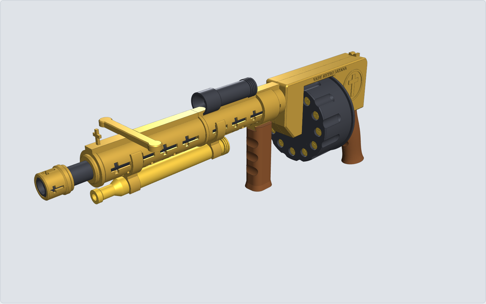

# Holy shotgun display prop

A 3D-printable display prop in the spirit of the crucifix shotgun from the film
Constantine (2005): a brass receiver, a twelve-shell drum, a barrel shroud with
cross-shaped vents, a crucifix along the top, a torch, and a removable Dragon's
Breath tube underneath.

It is a costume and shelf piece only. Nothing in it can chamber or fire
anything: the barrel is a sleeve over a solid rod, the drum is a free-spinning
ornament, and the shells are solid dummies.




| | |
|---|---|
| Assembled size | 594 mm long, 126 mm wide, 214 mm tall (about 23.4 in long) |
| Printed parts | 20 part types, 32 pieces |
| Filament | roughly 785 g at 3 walls and 15% infill |
| Printer | any bed of 220 x 220 mm or larger, 220 mm of height |
| Supports | none |

## How close is it to the film prop?

It is an interpretation, not a measured copy. It was designed from written
descriptions of the prop (about 23 inches long, a Striker-style drum holding
twelve 12-gauge shells, a cross-shaped sight, a torch on top, the Dragon's
Breath tube under the barrel, brass finish with Latin inscriptions) without
reference photos to measure from. Expect the overall layout to be right and the
fine detail to differ.

The two inscriptions, `VADE RETRO SATANA` and `LUX IN TENEBRIS`, are stand-ins
chosen for the theme. They are not a transcription of the film prop.

Everything is parametric, so the shape can be pushed closer to the screen
version by editing the values at the top of `model.py` and rebuilding.

## What is in this folder

| Path | What it is |
|---|---|
| `stl/` | One STL per printed part, already turned the way it should sit on the bed |
| `PARTS.md` | Print list: quantity, filament, size and orientation for each STL |
| `step/assembly.step` | The full assembly with named, coloured parts, for Fusion 360, FreeCAD and similar |
| `docs/` | Renders and line drawings (`side.svg`, `top.svg`, `iso.svg`, `exploded.svg`) |
| `viewer/` | Interactive 3D viewer with an exploded-view slider |
| `model.py` | The parametric model (build123d) |
| `build.py` | Checks the model and regenerates everything above |

## Printing

- 0.4 mm nozzle, 0.2 mm layers, 3 walls, 15% infill. PLA or PETG.
- Load each STL as it is. The orientation is already set and no part needs
  supports. A few internal pockets rely on short bridges of 22 mm or less.
- Use a brim on the tall, thin parts: `barrel_rear`, `barrel_front` and
  `dragon_tube`.
- Suggested colours: brass or gold for the receiver, shroud and crown; black or
  steel for the barrel, drum, shield, trigger and torch; gold for the shells
  and Dragon's Breath tube; a wood-fill filament for the grips.
- Print `foregrip_collar` and `foregrip_handle` first. They are small, and the
  way their dovetail slides tells you whether the clearances suit your printer
  before you commit to the large parts.

See [PARTS.md](PARTS.md) for the full print list.

## Hardware

| Item | Qty | Used for |
|---|---|---|
| 8 mm rod, 380 mm long | 1 | Barrel spine. Carries the bending load so the barrel joints do not have to |
| 8 mm rod, 88 mm long | 1 | Drum axle |
| M3 x 30 socket head screw | 8 | Receiver halves (5), grip tongue (2), trigger pivot (1) |
| M3 x 20 socket head screw | 2 | Grip halves |
| Ballpoint pen spring | 1 | Trigger return. Optional |
| Super glue or epoxy | | Barrel, shroud, torch, sights |

Aluminium tube, steel rod or a hardwood dowel all work for the 8 mm rod. The
screws thread directly into 2.8 mm pilot holes in the plastic; no nuts or
inserts are needed.

## Assembly

1. Screw the two grip halves together with the M3 x 20 screws.
2. Glue `barrel_rear` and `barrel_front` onto the 380 mm rod, leaving 14 mm of
   rod showing at the rear.
3. Lay `frame_right` on the table, outer face down. Drop in the grip tongue,
   the trigger with its spring, the recoil shield on its square boss, the drum
   on the 88 mm axle, and the rear end of the barrel.
4. Close `frame_left` over it and drive in the eight M3 x 30 screws from the
   right side. The drum should spin freely.
5. Slide `foregrip_collar` onto `shroud_rear` from its plain end. Slide the
   shroud down the barrel until its notch seats on the key at the front of the
   receiver. Follow with `shroud_front` and `muzzle_crown`.
6. Slide `foregrip_handle` onto the collar's dovetail. Glue the crossbar into
   its notch, the front sight into its slot, and the torch onto the top rib.
7. Snap the two cradles onto the front shroud and press the Dragon's Breath
   tube into them. It comes off again the same way.
8. Load the twelve shells through the gate on the right side of the recoil
   shield.

## Rebuilding and customising

```
pip install -r requirements.txt
python build.py            # checks, STL, STEP, drawings, viewer data, PARTS.md
python build.py --no-draw  # skip the line drawings, which take the longest
```

A full build takes under a minute. `build.py` exits with an error if any
printed part is not a single valid solid, does not fit the bed, or collides
with another part in the assembled prop.

Parameters worth knowing about, all at the top of `model.py`:

| Parameter | Default | Effect |
|---|---|---|
| `BED_X`, `BED_Y`, `BED_Z` | 220, 220, 250 | Printer envelope the bed-fit check uses |
| `FIT` | 0.15 | Radial clearance for glued joints. Raise it if parts are tight |
| `SLIDE` | 0.25 | Radial clearance for moving joints (drum on its axle) |
| `TEXT_LEFT`, `TEXT_RIGHT` | see above | The engraved inscriptions |
| `MUZZLE_X` | 560 | Overall barrel length |
| `N_CHAMBERS`, `DRUM_PITCH_R`, `DRUM_R` | 12, 47.5, 61.5 | Drum layout |

To view `viewer/index.html` locally, serve the folder
(`python -m http.server` inside `viewer/`) and open it in a browser. It loads
three.js from a CDN.

## What has and has not been checked

Checked by the build: every part is a valid single solid, every STL is
watertight, every part fits a 220 mm bed with margin, and no two parts overlap
in the assembled model. Overhangs were measured in print orientation and come
down to short bridges and small arches.

Not checked: the parts have not been sliced or printed. Fits depend on the
printer, so treat the clearances as a starting point.

## Carrying it

It still looks like a firearm from a distance. Print the muzzle crown in blaze
orange or paint the tip, and keep it in a bag when it is outside the house.
