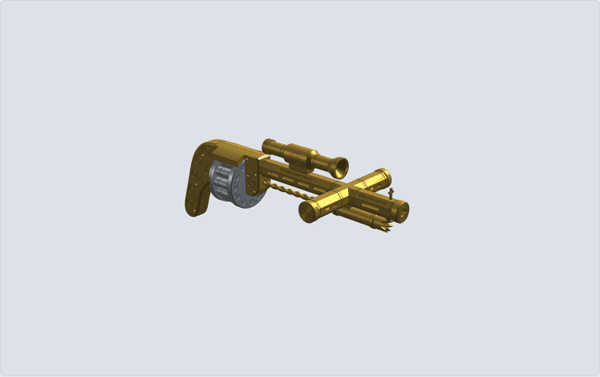
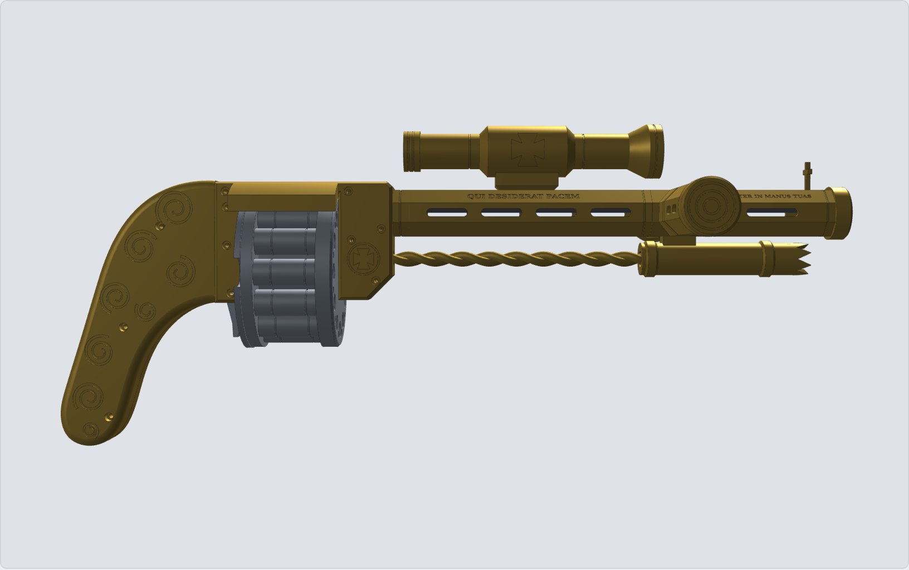
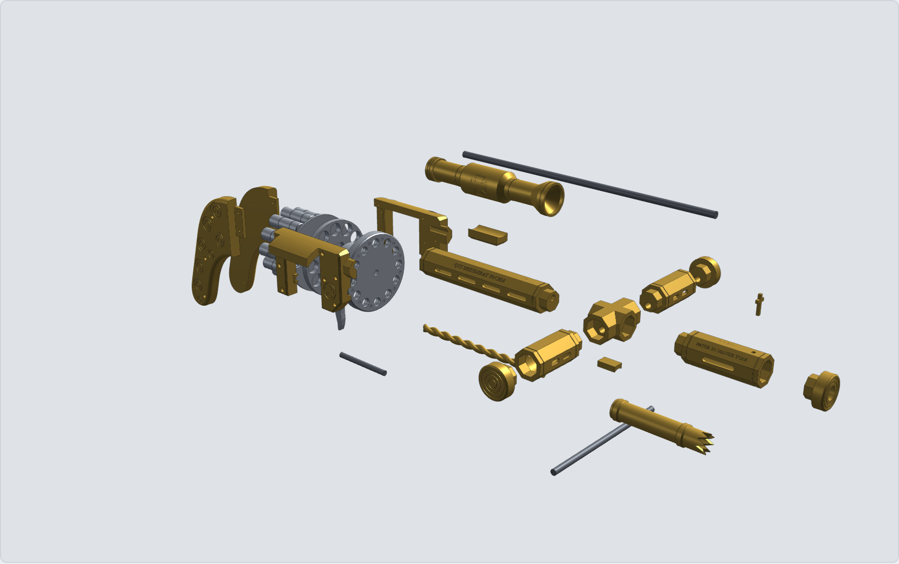

# Holy shotgun display prop

A 3D-printable display prop modelled on the crucifix shotgun from the film
Constantine (2005): a cross-shaped barrel with ringed end caps, an open
twelve-shell drum, a bird's-head grip, a long torch on top, and the Dragon's
Breath tube underneath on its twisted rod.

It is a costume and shelf piece only. Nothing in it can chamber or fire
anything: the barrel is a hollow sleeve over a solid rod, the drum is a
free-spinning ornament, and the shells are solid dummies.


How it comes apart:





| | |
|---|---|
| Assembled size | 581 mm long, 224 mm across the arms, 238 mm tall (about 22.9 x 8.8 x 9.4 in) |
| Printed parts | 21 part types, 34 pieces |
| Filament | roughly 700 g at 3 walls and 15% infill |
| Printer | any bed of 220 x 220 mm or larger, 230 mm of height |
| Supports | none |

## How close is it to the film prop?

The layout and proportions follow photos of the hero prop and a licensed
replica: the crucifix barrel, the drum cage with exposed shells, the curved
hood over the drum, the grip, the torch with its flared bell, and the crowned
lower tube. Nothing was measured from the original, so treat it as a close
likeness rather than a dimensional copy.

Known simplifications:

- The prop is covered in fine hand engraving. Here that is reduced to
  scrollwork on the grip, crosses on the receiver and torch, and border
  grooves on the barrel, because detail much finer than a 0.4 mm nozzle does
  not survive printing.
- The inscriptions are the ones legible in the photos, set in capitals so
  they print: `PATER IN MANUS TUAS` / `COMMENDO SPIRITUM` on the front of the
  barrel, `QUI DESIDERAT PACEM` and `BREVE ET EFFICAX PER EXEMPLA` on the
  rear. The prop carries more text than this.
- The trigger is a fixed spur. The photos do not show how the real one works.

Everything is parametric, so the shape can be adjusted by editing the values
at the top of `model.py` and rebuilding.

## What is in this folder

| Path | What it is |
|---|---|
| `stl/` | One STL per printed part, already turned the way it should sit on the bed |
| `PARTS.md` | Print list: quantity, filament, size and orientation for each STL |
| `step/assembly.step` | The full assembly with named, coloured parts, for Fusion 360, FreeCAD and similar |
| `docs/` | Renders, the pull-apart animation and line drawings (`side.svg`, `top.svg`, `iso.svg`, `exploded.svg`) |
| `viewer/` | Interactive 3D viewer with an exploded-view slider |
| `model.py` | The parametric model (build123d) |
| `build.py` | Checks the model and regenerates everything above |

## Printing

- 0.4 mm nozzle, 0.2 mm layers, 3 walls, 15% infill. PLA or PETG.
- Load each STL as it is. The orientation is already set and no part needs
  supports. A few hidden pockets rely on bridges of about 18 mm or less.
- Use a brim on the tall, thin parts: `barrel_tail`, `torch` and above all
  `twisted_rod`, which is 11 mm across and 202 mm tall. Print that one
  slowly.
- Two colours cover it. Brass for everything except the drum parts, recoil
  shield, shells and trigger, which are silver.
- Print `cross_hub` and one `barrel_arm` first. They are small, and the way
  the tenon fits the mortise tells you whether the clearances suit your
  printer before you commit to the large parts.

See [PARTS.md](PARTS.md) for the full print list.

## Hardware

| Item | Qty | Used for |
|---|---|---|
| 8 mm rod, 345 mm long | 1 | Barrel spine, from inside the receiver to the muzzle cap |
| 8 mm rod, 203 mm long | 1 | Cross spine, from arm cap to arm cap |
| 8 mm rod, 90 mm long | 1 | Drum axle |
| M3 x 30 socket head screw | 8 | Receiver halves (5), grip tongue (2), trigger (1) |
| M3 x 20 socket head screw | 3 | Grip halves |
| Super glue or epoxy | | Barrel joints, torch, sight, Dragon's Breath tube |

One 1 m length of 8 mm rod covers all three pieces. Aluminium tube, steel rod
or a hardwood dowel all work. The rods carry the bending load, so the printed
barrel joints only have to locate the sleeves. The two long rods cross inside
the hub, which is why one runs 4.5 mm above the barrel centreline and the
other 4.5 mm below it.

The screws thread directly into 2.8 mm pilot holes in the plastic; no nuts or
inserts are needed.

## Assembly



1. Screw the two grip halves together with the M3 x 20 screws.
2. Glue `drum_rear` onto the hex spigot of `drum_core`.
3. Lay `receiver_right` on the table, outer face down. Drop in the grip
   tongue, the trigger, the recoil shield on its square boss, the drum on the
   90 mm axle, and the rear end of the 345 mm spine rod.
4. Close `receiver_left` over it and drive in the eight M3 x 30 screws from
   the right side. The drum should spin freely.
5. Slide `barrel_tail` down the spine rod onto the receiver, then `cross_hub`.
   Push the 203 mm rod through the hub and slide a `barrel_arm` and an
   `arm_cap` onto each side. Finish the spine with `barrel_head` and
   `muzzle_cap`. Glue each joint as you go.
6. Glue `torch_pedestal` to the top of the rear sleeve, 76 mm ahead of the
   receiver, and set the torch in it with the bell facing forward. Glue the
   cross sight into its slot at the muzzle.
7. Glue `dragon_mount` under the hub. Push the twisted rod into the socket at
   the front of the receiver, slide `dragon_tube` onto its free end, and glue
   the tube to the mount.
8. Load the twelve shells through the gate on the right side of the recoil
   shield.

## Rebuilding and customising

```
pip install -r requirements.txt
python build.py            # checks, STL, STEP, drawings, viewer data, PARTS.md
python build.py --no-draw  # skip the line drawings, which take the longest
```

A full build takes about a minute. `build.py` exits with an error if any
printed part is not a single valid solid, does not fit the bed, collides with
another part in the assembled prop, or if the drum cannot turn without
touching something.

Parameters worth knowing about, all at the top of `model.py`:

| Parameter | Default | Effect |
|---|---|---|
| `BED_X`, `BED_Y`, `BED_Z` | 220, 220, 250 | Printer envelope the bed-fit check uses |
| `FIT` | 0.15 | Radial clearance for glued joints. Raise it if parts are tight |
| `SLIDE` | 0.25 | Radial clearance for the drum on its axle |
| `OCT_AF` | 34 | Barrel thickness, across the flats of the octagon |
| `TAIL_LEN`, `HEAD_LEN`, `ARM_LEN` | 190, 90, 68 | Lengths of the four barrel sleeves, which set the cross proportions |
| `N_CHAMBERS`, `DRUM_PITCH_R`, `DRUM_R` | 12, 43.5, 56 | Drum layout |
| `TEXT_*` | see above | The engraved inscriptions |

To view `viewer/index.html` locally, serve the folder
(`python -m http.server` inside `viewer/`) and open it in a browser. It loads
three.js from a CDN.

## What has and has not been checked

Checked by the build: every part is a valid single solid, every part fits a
220 mm bed with margin, no two parts overlap in the assembled model, and the
drum clears everything at three positions between one chamber and the
next.

Checked by hand for this release: every STL is watertight, and overhangs
measured in print orientation come down to short bridges and small arches.

Not checked: the parts have not been run through a slicer or printed, and the
assembly order has been reasoned through but not tried. Fits depend on the
printer, so treat the clearances as a starting point.

## Carrying it

It still looks like a firearm from a distance. Print the muzzle cap in blaze
orange or paint the tip, and keep it in a bag when it is outside the house.
